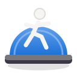

# Bosu

<p align="center"></p>

**Entender cómo responde tu cuerpo y acompañar tu proceso, a tu ritmo.**

Bosu es un diario local de rehabilitación para GNOME, escrito en Rust, GTK4 y Libadwaita.
Puedes practicar, adaptar una sesión o descansar. Hacer una parte también es progreso.

## Tu sesión

En **Hoy** eliges una rutina o descanso. El recorrido es:

1. **Cómo estoy:** mapa corporal opcional antes de empezar.
2. **Lo que hice:** ejercicios hechos, pendientes u omitidos, con repeticiones reales,
   peso, asistencia o una nota opcional. Las categorías alternan la paleta de la app.
3. **Cómo quedé:** mapa posterior, dolor y esfuerzo como mediciones separadas de 0 a 10,
   fecha y notas. Cualquier medición puede quedar sin registrar.

**Guardar mi avance permite sesiones incompletas.** Una sesión con actividad parcial
queda registrada y suma un día de práctica. Varios registros en un mismo día cuentan como
un solo día para la meta semanal. Descanso y sensaciones también se pueden guardar y se
muestran con su propia categoría. Las partes de kine ya no requieren completarse o
emparejarse para reconocer que hubo actividad.

Cada rutina conserva su propio borrador. Se guarda automáticamente al editar y al cambiar
de vista, rutina o cerrar. Si falla una escritura, se informa del error y el contenido
permanece abierto para reintentar. El guardado de una sesión y sus mapas es una sola operación.

Al guardar, **Hoy** conserva visibles los ejercicios de la última sesión de esa rutina
en el día. Puedes continuarla: guardar de nuevo actualiza ese registro sin duplicarlo.
Un borrador con cambios pendientes tiene prioridad; un formulario vacío no oculta lo
que ya guardaste hoy. Descartar el borrador vuelve a la sesión guardada si existe.

Las rutinas personales **Sesión Kine Full** y **Sesión Kine · Pared, suelo, TRX y barra**
pueden editarse en Preferencias. Las antiguas partes 1 y 2 se unen automáticamente en una sola rutina,
con un calentamiento inicial y los estiramientos al final. Los estiramientos están al final de las
rutinas de kine y la variante de mantener 5 segundos sigue siendo opcional.

## Cuerpo y evolución

El modelo de [hugobonifay/body-map](https://github.com/hugobonifay/body-map) tiene 73 zonas:
39 frontales y 34 posteriores, con nombre y descripción. Puedes elegir una zona por su
nombre, crear puntos, moverlos y editar dolor, tensión, cansancio, irritación, trabajado o
fuerte, junto a su intensidad de 0 a 10. También puedes usar los botones sin arrastrar ni
clic derecho. Los registros de la silueta anterior conservan su dibujo original.

En **Cuerpo → Evolución**, los mapas independientes y los vinculados a sesiones se consultan
con una escala fija. Puedes filtrar por sensación, período y antes/después, recorrer fechas,
reproducir la secuencia o exportar un **GIF animado**. El gráfico incluye valores textuales.
Los mapas vinculados se agrupan por la fecha de su sesión; la marca de tiempo original se
conserva en los datos guardados.

Una zona sin marcar significa **sin datos**, no dolor cero. Los puntos antiguos sin intensidad
se muestran con `?`. El cero solo aparece si se registra explícitamente. Varios puntos de
la misma sensación en una zona utilizan el máximo; no se suman. Los cuadros del GIF son
registros reales a intervalos fijos de 800 ms, sin interpolar días ni sensaciones.

## Progreso sin presión

- Metas semanales de días con práctica, incluyendo sesiones parciales.
- Días activos, sesiones parciales y descansos de los últimos 30 días.
- Dolor y esfuerzo separados, con el número de mediciones usado en cada promedio.
- Calendario que agrega todos los registros del día y distingue descanso de ausencia de datos.
- Actualización al guardar, restaurar o eliminar, sin reiniciar la app.

Los valores antiguos que mezclaban molestia y esfuerzo se conservan como registros anteriores
y no se convierten automáticamente en dolor. No hay rachas ficticias ni sugerencias automáticas
de subir cargas. Los recordatorios son opcionales, configurables y posponibles; funcionan
mientras la app está abierta. Descansar no dispara mensajes de culpa.

## Datos y recuperación

No se necesitan cuentas, conexión ni telemetría. La versión 0.2 utiliza un almacén versionado
único, `bosu_data.json`, en el directorio de datos del usuario (`$XDG_DATA_HOME`, normalmente
`~/.local/share`). Incluye configuración, sesiones, mapas, borradores y preferencias. Las
escrituras usan un archivo temporal privado, sincronización y reemplazo atómico.

En el primer inicio se migran `bosu_config.json`, `bosu_history.jsonl` y `bosu_body.json` si
existen. **Los originales se conservan.** Si un archivo no se puede leer, Bosu detiene la
migración y ofrece reintentar, abrir la carpeta o restaurar un respaldo; no reemplaza el
archivo dañado por valores predeterminados.

Preferencias → Datos permite exportar/restaurar un respaldo completo. La restauración valida
su contenido y guarda una copia previa en `backups/`. Eliminar una sesión incluye sus mapas;
**Deshacer** restaura el conjunto. La última eliminación puede deshacerse después de reiniciar.
Los respaldos y GIF usan GIO para respetar los archivos concedidos por el portal de GNOME.

En Flatpak los datos viven dentro de `~/.var/app/org.diego.Bosu/data`. Para pasar de la
instalación nativa a Flatpak, exporta un respaldo desde la primera e impórtalo en la segunda.
Los antiguos respaldos de tres archivos pueden recuperarse como datos de migración antes del
primer inicio de la versión 0.2; los respaldos nuevos contienen todo en un JSON.

## Compilar e instalar

Requiere Rust reciente (edición 2024), GTK ≥ 4.12, Libadwaita ≥ 1.4 y herramientas de desarrollo
de GLib (`glib-compile-resources`). En Arch Linux: `rust`, `base-devel`, `gtk4`, `libadwaita` y `glib2`.

```sh
cargo build --release --locked
./target/release/bosu
```

Para trabajar sin red después de descargar las dependencias, añade `--offline`.
La instalación de usuario no necesita `sudo`:

```sh
./scripts/install-local.sh
```

Instala el ejecutable en `~/.local/bin`, el lanzador, el icono y la activación D-Bus.
El icono y los estilos también están integrados en el binario para el uso desde el proyecto.
La vista Hoy conserva las casillas y los colores de cada categoría. Los datos reales y la omisión de ejercicios se editan desde el botón de detalles de cada fila. Progreso mantiene tarjetas, círculos semanales y el heatmap. La explicación del funcionamiento está en Acerca de, fuera del flujo diario. El menú principal incluye Preferencias, atajos y Acerca de. `Ctrl+1`, `Ctrl+2` y `Ctrl+3`
recorren las vistas; `Ctrl+,` abre Preferencias y `Ctrl+Q` cierra guardando el borrador.

## Flatpak

El manifiesto usa GNOME 50 y Rust estable. Las 94 dependencias de Cargo están fijadas por
`Cargo.lock`, con sus checksums y fuentes para compilar sin red. La app no solicita permisos
de red ni acceso general al sistema de archivos.

```sh
python scripts/generate-flatpak-sources.py
flatpak-builder --user --install --force-clean build-dir build-aux/org.diego.Bosu.json
flatpak run org.diego.Bosu
```

Instala antes `flatpak-builder`, GNOME Platform/SDK 50 y la extensión de Rust estable.
El workflow **Flatpak bundle** genera un `.flatpak` como artefacto para revisión; no publica
la app en ninguna tienda. Metadatos e iconos están en `data/`.

## Traducción, pruebas y desarrollo

La interfaz admite español e inglés. Preferencias → Acompañamiento permite elegir el idioma
para el siguiente inicio. Los textos personales de rutinas y notas no se traducen. Edita
`po/en.po` y ejecuta `python scripts/compile-translations.py`; el catálogo compilado se integra
en el binario. Las pruebas comprueban que las traducciones conserven sus parámetros.

```sh
cargo fmt --all -- --check
cargo test --locked --offline
cargo clippy --locked --offline -- -D warnings
```

Los SVG y su atribución están en `src/assets/body-map/`. Si cambias las formas, regenera las
máscaras con `python scripts/build_body_masks.py` (requiere Pillow y `rsvg-convert`).

La revisión de una versión, la prueba GTK con Xvfb, la comprobación independiente del GIF y
las capturas reales para GNOME se describen en [docs/RELEASE.md](docs/RELEASE.md). Los workflows
de CI están en `.github/workflows/`. La licencia del código y el icono original es MIT;
consulta también la atribución del modelo corporal antes de distribuir una versión pública.

## Testing · Movimiento (experimental)

En el menú principal, **Testing · Movimiento** abre un laboratorio en el navegador
mediante un servidor de solo lectura en `127.0.0.1`, activo mientras Bosu esté abierto.
La primera carga requiere conexión para descargar MediaPipe Tasks Vision (0.10.32)
y el modelo Pose Landmarker Lite. El video y las poses se procesan en el navegador;
no se envían al servidor ni se incorporan al diario o a sus respaldos.

1. Pulsa **Cargar MediaPipe** y abre un video local o concede acceso a la cámara.
2. Con la cámara, pulsa **Grabar ejemplo** y luego **Detener grabación**.
   Puedes descargar la grabación antes de cerrar la página.
3. Revisa el video a 5 FPS con los botones de cuadro o la barra. Marca el inicio y
   el fin de una repetición completa (incluido el regreso), entre 0,8 y 30 segundos.
4. Pulsa **Usar repetición como patrón**. Abre otro video o vuelve a la cámara,
   pulsa **Iniciar conteo** y reproduce el video si corresponde.
5. Exporta el patrón JSON si quieres reutilizarlo. Al cerrar se pierden los datos
   no exportados. **Apagar cámara** libera el dispositivo.

El esqueleto muestra los 33 puntos de Pose Landmarker; la comparación utiliza las
extremidades y el torso normalizados por posición y tamaño. Exige visibilidad del
cuerpo completo y progreso ordenado por el ejemplo, con umbrales experimentales.
Mantén el encuadre y la orientación: no reconoce cambios de perspectiva ni refleja
el patrón automáticamente. No evalúa la técnica y no modifica las repeticiones del
diario. Esta versión es un prototipo para validar el conteo con movimientos reales.

El laboratorio requiere un navegador con cámara y MediaRecorder para grabar.
El paquete Flatpak sigue sin acceso de red: la compatibilidad de este lanzamiento
externo con los portales debe verificarse antes de distribuirlo como función estable.

Validación del contador: `node scripts/test-motion.mjs`.
Referencia de integración: [MediaPipe Pose Landmarker para web](https://ai.google.dev/edge/mediapipe/solutions/vision/pose_landmarker/web_js).

## Modo enfoque (prueba de diseño)

Al iniciar Bosu se abre directamente **Modo enfoque (prueba)**. También está disponible
en el menú del diario. Muestra una ventana con un ejercicio a la vez,
fondo de un solo color según la categoría, texto grande y controles mínimos.
Parte de las marcas que ya tienes en la rutina de hoy y comienza por el primer
pendiente. Las marcas se conservan como borrador al avanzar o cerrar la ventana.
Al terminar, **Guardar avance** registra la sesión o actualiza la de hoy sin duplicarla.
El resumen admite notas, dolor y esfuerzo opcionales. Los mapas y demás datos que
ya tenía la sesión se conservan.

- **✓ / Enter:** marcar listo y avanzar.
- **Ícono de saltar / S:** registrar el ejercicio como omitido y continuar, sin contarlo como hecho.
  Puedes volver con la flecha y marcarlo como listo si decides hacerlo después.
- **← / →:** revisar sin marcar ejercicios. Las opciones están en el menú de la sesión.
- Temporizador opcional de 30, 60, 90 o 120 segundos; **Espacio** lo inicia o pausa.
- El temporizador se pausa al salir de la ventana y se reinicia al cambiar de ejercicio.
  Al terminar el tiempo espera tu confirmación; no marca ni avanza automáticamente.
- Botón de pantalla completa; **Escape** permite salir de ella.

Es una alternativa experimental para probar la interacción antes de cambiar el
flujo principal. El formulario habitual se actualiza al cerrar la sesión guiada.

La apariencia ofrece **Sistema, Claro y Oscuro**, desde el botón de apariencia en
la parte inferior del modo enfoque o **Preferencias → Acompañamiento → Apariencia**.
La elección se conserva al reiniciar y se aplica a toda la app. De forma predeterminada
sigue el sistema. Los fondos azul, verde, morado y naranja se adaptan a las superficies
de Adwaita; botones y texto conservan sus estilos nativos, incluido alto contraste.
Referencia: [GNOME HIG · UI Styling](https://developer.gnome.org/hig/guidelines/ui-styling.html).

El modo enfoque no tiene barra de título ni decoraciones. Los controles discretos
al pie permiten cambiar la apariencia, abrir las opciones, alternar pantalla completa
y salir conservando el borrador. Puedes mover la ventana arrastrando el fondo.

### Vista de práctica a distancia

El nombre del ejercicio ocupa el espacio central y ajusta su tamaño a la ventana,
incluso con nombres largos. El botón de información muestra el nombre completo,
la categoría y las repeticiones previstas. Los demás controles están en los tres
puntos de abajo a la derecha; **Enter** y **S** funcionan con el menú cerrado.
La barra superior tiene un segmento por ejercicio: verde hecho, amarillo omitido y
neutro pendiente. Una marca indica la posición actual. Los estados también tienen
texto para lectores de pantalla y al pasar el puntero; en alto contraste se usan
superficies del sistema y bordes distintos.
