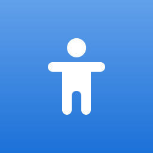

# Bosu 

<p align="center">
  
</p>

<p align="center">
  <em>A Kinesiological Rehabilitation Tracker built natively for the GNOME Desktop.</em>
</p>

<p align="center">
  
  
  
</p>

## Overview

**Bosu** is a specialized tracking application designed specifically for physical rehabilitation (such as dorsalgia and scapular dyskinesia). Unlike traditional fitness or HIIT apps that focus on speed and intensity, Bosu is built for **mindful, slow, and analytical tracking** of your daily physical therapy routines.

It is built completely in **Rust** using **GTK4** and **Libadwaita**, ensuring a gorgeous, native, and perfectly integrated experience on any modern Linux desktop (GNOME 45+).

## Features

- **Native GNOME Experience**: Fully compliant with the GNOME Human Interface Guidelines (HIG). Uses `AdwViewSwitcher`, `AdwPreferencesGroup`, and native symbolic iconography.
- **Intelligent Kinesiology Alerts**: Built-in analytics act as a virtual physical therapist. It analyzes your pain trends and uses `AdwBanner` to suggest increasing weights or consulting your doctor.
- **Activity Heatmap**: A GitHub-style monthly adherence heatmap that dynamically colors cells based on your completion percentage.
- **Progress Dashboard**: View your current streak, average pain levels, and a custom native Bar Chart tracking your pain vs. improvement over the last 7 sessions.
- **Local-First & Private**: Your health data is yours. Bosu saves everything locally in `~/.local/share/bosu_history.jsonl` using efficient JSON serialization. No cloud, no telemetry.

## Installation & Building

Make sure you have Rust and the GTK4 development libraries installed on your system.

### Prerequisites (Arch Linux)
```bash
sudo pacman -S rustup base-devel gtk4 libadwaita
```

### Build & Run
Clone the repository and run it via Cargo:
```bash
git clone https://github.com/diegoveraniego/bosu.git
cd bosu
cargo run --release
```

## Motivation

This project was born out of a personal need to track specific kinesiologic exercises (like Scapular Dyskinesia rehabilitation) methodically. By tracking pain levels and completion rates visually, it's easier to maintain discipline and provide accurate feedback to physical therapists. 

## License

This project is licensed under the MIT License.

## Registro corporal y sesiones Kine

La pestaña **Cuerpo** permite marcar frente y espalda con seis sensaciones: dolor, tensión, cansancio, irritado, trabajado y fuerte. Elige una sensación y pulsa para crear un punto; arrástralo para moverlo, pulsa sobre él para cambiar su color o usa clic derecho para eliminarlo. **Guardar registro corporal** conserva ambas vistas con fecha y hora. Selecciona registros anteriores para comparar; cada guardado crea una entrada nueva. Limpiar el mapa no borra el historial.

El modelo detallado usa las **73 zonas de [hugobonifay/body-map](https://github.com/hugobonifay/body-map)**: 39 frontales y 34 posteriores. Al pasar el puntero o seleccionar una zona aparece su nombre y descripción en español; izquierda y derecha corresponden al cuerpo de la persona. También puedes buscar una zona por nombre y pulsar **Marcar zona seleccionada**. Los puntos nuevos solo se colocan dentro de una zona y guardan su identificador junto a la sensación. Puedes borrar un punto con clic derecho o con **Eliminar punto seleccionado**.

Los registros anteriores se abren sobre su silueta original para conservar la ubicación de sus puntos. **Nuevo registro · limpiar mapa** inicia un mapa SVG nuevo sin borrar el historial.

Los SVG originales adaptados y la atribución están en `src/assets/body-map/`. Para el dibujo nativo se incluyen máscaras alfa derivadas de los SVG, sin React ni descargas durante la ejecución. Si cambias las formas, regenera las máscaras con `python scripts/build_body_masks.py` (requiere Pillow y `rsvg-convert`).

Los mapas se almacenan en `~/.local/share/bosu_body.json` (o en `$XDG_DATA_HOME`) y se incluyen en los respaldos. El registro corporal se guarda independientemente de la sesión de ejercicios, también en días de descanso.

Se agregan automáticamente **Sesión Kine · Pared y suelo** y **Sesión Kine · TRX y barra**, sin reemplazar rutinas existentes. Ambas incluyen calentamiento de 15 minutos y estiramientos al final. La primera indica la variante opcional de mantener 5 segundos, excepto en el saludo al sol. Puedes ajustar nombres, repeticiones y metas semanales en Configuración → Editor. Las metas iniciales son de un día por rutina; ajústalas a tu planificación.

Para continuar el desarrollo:

```bash
cargo test --offline
cargo build --release --offline
./target/release/bosu
```
